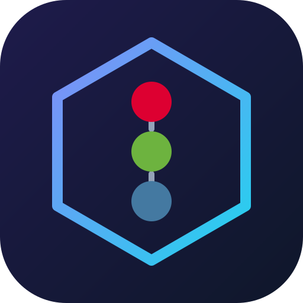
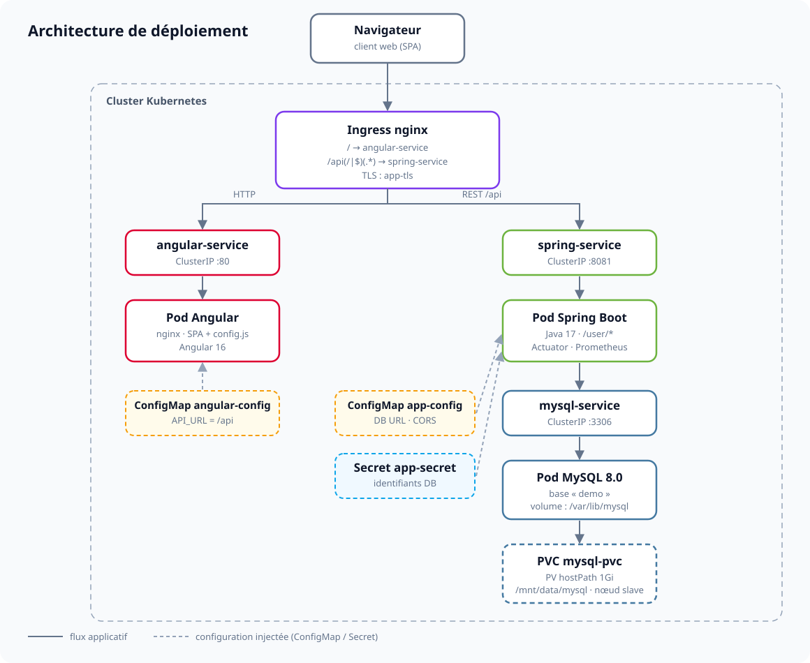

<div align="center">
  
  <h1>Deployment — Full-Stack sur Kubernetes</h1>
  <p><b>Angular 16 · Spring Boot 3.3 · MySQL 8 · Docker · Kubernetes</b></p>

  
  
  
  
  
  
  
</div>

---

Application de démonstration **full-stack** (CRUD utilisateurs) entièrement conteneurisée et déployée sur un cluster **Kubernetes** : un frontend **Angular** servi par nginx, une API **Spring Boot** connectée à une base **MySQL** persistante, le tout exposé via un **Ingress**.

## Architecture

<div align="center">
  
</div>

| Composant | Rôle | Port |
|---|---|---|
| **Ingress nginx** | Point d'entrée unique : `/` vers Angular, `/api` vers Spring | 80 / 443 |
| **angular-service** | Frontend statique Angular 16 (nginx + `config.js`) | 80 |
| **spring-service** | API REST Spring Boot (`/user/all`, `/user/add`, `/user/delete/{id}`) | 8081 |
| **mysql-service** | Base de données MySQL 8 avec volume persistant | 3306 |

La configuration de l'API est injectée à l'exécution : le conteneur Angular génère `/usr/share/nginx/html/config.js` depuis la variable `API_URL` (ConfigMap `angular-config`), lue dans `src/environments/environment.ts`.

## Stack technique

| Couche | Technologie | Détails |
|---|---|---|
| Frontend | **Angular 16** | TypeScript, `HttpClient`, build multi-stage Node 16 → nginx |
| Backend | **Spring Boot 3.3 / Java 17** | Spring Web, Spring Data JPA, Actuator + Prometheus |
| Base de données | **MySQL 8.0** | `spring.jpa.hibernate.ddl-auto=update` |
| Conteneurs | **Docker** | Images `lotfimakhlouf2/angular-app:1.0` et `lotfimakhlouf2/spring-app:1.0` |
| Orchestration | **Kubernetes** | Deployments, Services, ConfigMaps, Secret, PV/PVC, Ingress |

## Structure du projet

```text
deployment/
├── angular-app/                # Frontend Angular 16
│   ├── src/app/                # Composants, services, modèles
│   ├── Dockerfile              # Build multi-stage (Node → nginx)
│   └── nginx.conf              # SPA fallback (try_files)
├── springboot/app/             # API Spring Boot (Maven)
│   ├── src/main/java/com/oauth/demo/
│   │   ├── controllers/        # UserController
│   │   ├── services/           # UserService
│   │   ├── repositories/       # UserRepository
│   │   └── entities/           # User
│   └── Dockerfile              # eclipse-temurin:17-jre
├── k8s/
│   ├── angular-deployment.yaml # Deployment + Service Angular
│   ├── spring-deployment.yaml  # Deployment + Service Spring
│   ├── mysql-deployment.yaml   # Deployment + Service MySQL
│   ├── mysql-pv-pvc.yaml       # PersistentVolume + PersistentVolumeClaim
│   ├── configmap.yaml          # app-config + angular-config
│   ├── secret.yaml             # app-secret (identifiants base64)
│   └── ingress.yaml            # Ingress Angular (/) et Spring (/api)
└── docs/                       # Logo et schéma d'architecture
```

## Démarrage rapide (local)

### 1. API Spring Boot

```bash
cd springboot/app

export SPRING_DATASOURCE_URL="jdbc:mysql://localhost:3306/demo?useSSL=false&allowPublicKeyRetrieval=true"
export SPRING_DATASOURCE_USERNAME=root
export SPRING_DATASOURCE_PASSWORD=<mot_de_passe>
export CORS_ALLOWED_ORIGIN="http://localhost:4200"

./mvnw spring-boot:run
```

### 2. Frontend Angular

```bash
cd angular-app
npm install
npm start
```

Le proxy de développement (`proxy.config.json`) redirige `/api` vers l'API — adaptez la cible si nécessaire.

## Construction des images Docker

```bash
# API Spring Boot (générer d'abord target/demo-0.0.1.jar avec ./mvnw package)
cd springboot/app
docker build -t lotfimakhlouf2/spring-app:1.0 .
docker push lotfimakhlouf2/spring-app:1.0

# Frontend Angular
cd angular-app
docker build -t lotfimakhlouf2/angular-app:1.0 .
docker push lotfimakhlouf2/angular-app:1.0
```

## Déploiement Kubernetes

```bash
# 1. Secret et ConfigMaps
kubectl apply -f k8s/secret.yaml
kubectl apply -f k8s/configmap.yaml

# 2. Stockage persistant
kubectl apply -f k8s/mysql-pv-pvc.yaml

# 3. Base de données et applications
kubectl apply -f k8s/mysql-deployment.yaml
kubectl apply -f k8s/spring-deployment.yaml
kubectl apply -f k8s/angular-deployment.yaml

# 4. Routage externe
kubectl apply -f k8s/ingress.yaml

# Vérification
kubectl get pods,svc,ingress
```

> **Prérequis** : Docker, `kubectl`, un cluster Kubernetes avec l'**ingress-nginx controller**, et un StorageClass compatible (ou adapter le PV).

## Points d'attention

| Sujet | Détail |
|---|---|
| **Secret TLS** | Les Ingress référencent `app-tls`. Créez-le avant l'application (ou retirez la section `tls`) : `kubectl create secret tls app-tls --cert=tls.crt --key=tls.key` |
| **CORS** | `CORS_ALLOWED_ORIGIN` (ConfigMap `app-config`) doit correspondre à l'URL réelle du frontend |
| **Persistance** | Le PV utilise un `hostPath` `/mnt/data/mysql` avec `nodeAffinity` sur le nœud `slave` — à adapter à votre cluster |
| **Images** | `imagePullPolicy: IfNotPresent` — sur un cluster multi-nœuds, préférer un registry (Docker Hub / registry privé) |
| **Sécurité** | Le Secret contient des identifiants de démonstration encodés en base64 (non chiffrés) — à remplacer en production |

---

<div align="center">
  <sub>Projet de démonstration — Angular · Spring Boot · MySQL · Kubernetes</sub>
</div>
